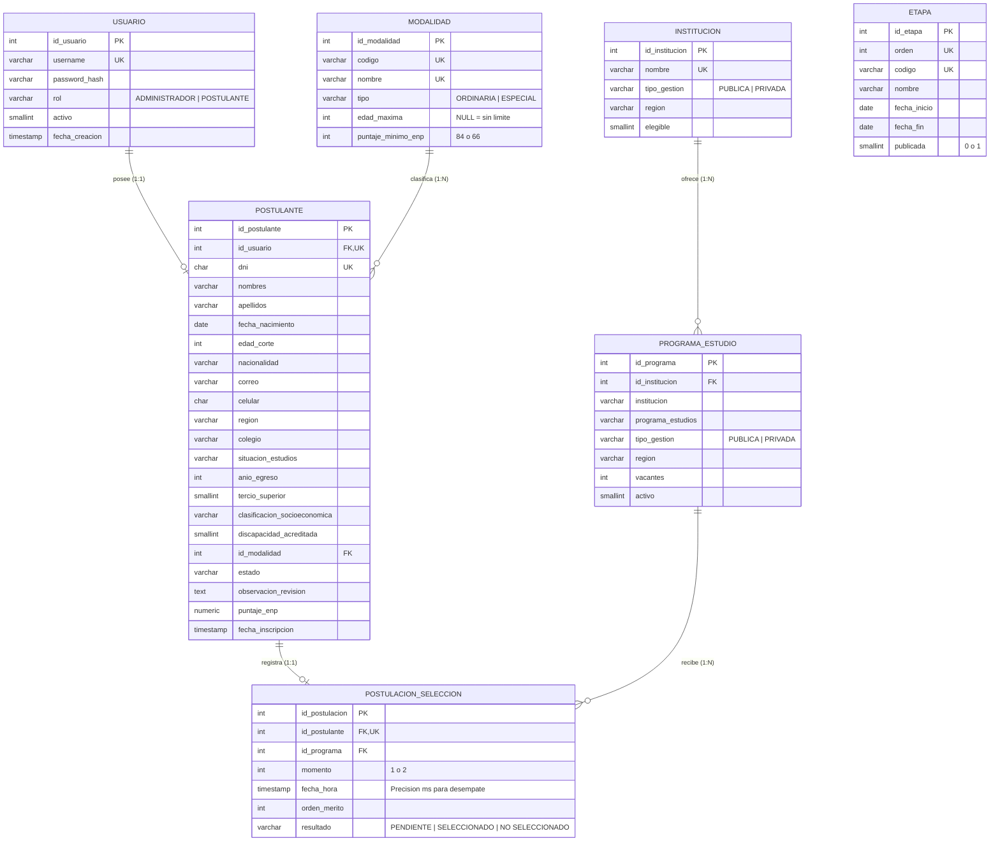

# SIBECA-18 – Sistema Web de Seguimiento del Proceso Beca 18 (Convocatoria 2027)

Aplicación web académica desarrollada en **Java 17**, **Jakarta EE 10 (Servlet 6.0 + JSP 3.1 + EL)**, **JDBC con DataSource JNDI**, **PostgreSQL 17 (pgAdmin 4)**, **Bootstrap 5.3** y **jQuery 3.7**, bajo los patrones arquitectónicos **MVC (Modelo-Vista-Controlador)** y **DAO (Data Access Object)**.

Cumple íntegramente las especificaciones del documento `Examen_Practico_03.pdf`:
- **16 Requerimientos Funcionales (`RF-01` a `RF-16`)**: Obligatorios y complementarios (incluyendo el reto opcional `7.4` con hilos sincronizados en segundo plano).
- **14 Reglas de Negocio (`RN-01` a `RN-14`)**: Validadas mediante la excepción personalizada `ReglaNegocioException`.
- **18 Casos de Prueba (`CP-01` a `CP-18`)**: Ejecutados y verificados contra la base de datos real `beca` en **PostgreSQL 17 (puerto `5433`)**.
- **Restricciones técnicas respetadas**: Sin Spring Boot, sin JPA/Hibernate, sin JSTL, sin Ajax y sin Listeners.

---

## 1. Estructura de Carpetas del Proyecto

```text
Beca18/
├── pom.xml                                      # Configuración Maven WAR (Java 17, Jakarta EE 10, PostgreSQL JDBC 42.7.4)
├── nb-configuration.xml                         # Configuración compartida compatible con Apache NetBeans
├── .gitignore                                   # Exclusión de secretos locales (META-INF/context.xml, logs, target)
├── README.md                                    # Documentación técnica, manuales y matriz de pruebas CP-01..CP-18
├── database/
│   ├── schema.sql                               # DDL PostgreSQL (pgAdmin 4): Tablas, PK, FK, CHECK e índices
│   ├── seed.sql                                 # DML PostgreSQL: Admin, 9 modalidades, 8 etapas, 5 IES/programas y 12 postulantes
│   ├── sibeca18_completo.sql                    # Script SQL unificado (schema + seed) listo para pgAdmin 4 Query Tool
│   └── context.xml.example                      # Plantilla de configuración JNDI sin credenciales versionadas
├── src/
│   ├── main/
│   │   ├── java/pe/edu/sibeca18/
│   │   │   ├── model/                           # POJOs: Usuario, Modalidad, Etapa, Postulante, Institucion, ProgramaEstudio, PostulacionSeleccion, BitacoraEvento
│   │   │   ├── dao/                             # Interfaces DAO: UsuarioDAO, ModalidadDAO, EtapaDAO, PostulanteDAO, InstitucionDAO, ProgramaDAO, PostulacionSeleccionDAO
│   │   │   ├── dao/impl/                        # Implementaciones JDBC (PreparedStatement + ResultSet + try-with-resources)
│   │   │   ├── service/                         # Lógica de negocio y transacciones: AuthService, PostulanteService, CronogramaService, CatalogoService, SeleccionService
│   │   │   ├── controller/                      # Servlets MVC: AuthServlet, InscripcionPublicaServlet, PostulanteServlet, AdminDashboardServlet, AdminPostulantesServlet, AdminCronogramaServlet, AdminCatalogoServlet, AdminSeleccionServlet
│   │   │   ├── filter/                          # Seguridad: AuthFilter (protección de rutas y control de roles con HttpSession)
│   │   │   ├── util/                            # ConexionDB (DataSource JNDI), FormatoUtil (es-PE), ValidadorUtil (Regex), PasswordUtil (SHA-256), BitacoraUtil (E/S TXT)
│   │   │   └── exception/                       # ReglaNegocioException, AccesoDatosException
│   │   └── webapp/
│   │       ├── index.html                       # Redirección inicial al portal de autenticación (/auth?accion=login)
│   │       ├── META-INF/context.xml             # Configuración local del DataSource JNDI (excluido en .gitignore)
│   │       ├── WEB-INF/
│   │       │   ├── web.xml                      # Descriptor Jakarta EE 10 con resource-ref jdbc/sibeca18DS
│   │       │   └── views/
│   │       │       ├── auth/login.jsp           # Inicio de sesión institucional
│   │       │       ├── postulante/              # Vistas del beneficiario (formulario-inscripcion.jsp reutilizado, mi-estado.jsp, mis-resultados.jsp, postulacion-seleccion.jsp reutilizado)
│   │       │       ├── admin/                   # Vistas del administrador (dashboard.jsp, postulantes.jsp, postulante-detalle.jsp, cronograma.jsp, programas.jsp, seleccion.jsp, bitacora.jsp)
│   │       │       └── shared/                  # Fragmentos reutilizables (head.jsp, navbar.jsp, admin-sidebar.jsp, footer.jsp, acceso-denegado.jsp)
│   │       └── assets/
│   │           ├── css/sibeca18.css             # Diseño institucional (paleta azul, celeste y blanco)
│   │           ├── js/validaciones.js           # Validaciones en cliente con jQuery y Bootstrap 5
│   │           └── img/logo-sibeca18.svg        # Logotipo vectorial institucional
│   └── test/
│       └── java/pe/edu/sibeca18/
│           └── CasosPruebaSibeca18Test.java     # Suite de pruebas JUnit 5 de CP-01 a CP-18 sobre PostgreSQL
└── target/
    └── Beca18.war                               # Paquete WAR generado por Maven listo para despliegue
```

---

## 2. Diagrama Entidad-Relación (Modelo de Datos PostgreSQL 17)



---

## 3. Configuración de PostgreSQL (pgAdmin 4) y DataSource JNDI

### 3.1 Parámetros de Conexión Configurados
- **Servidor**: `localhost`
- **Puerto**: `5433`
- **Base de datos**: `beca`
- **Usuario**: `postgres`
- **Driver JDBC**: `org.postgresql.Driver` (`org.postgresql:postgresql:42.7.4`)
- **URL JDBC**: `jdbc:postgresql://localhost:5433/beca`

### 3.2 Carga en pgAdmin 4
La base de datos `beca` en el puerto `5433` **ya ha sido creada y poblada automáticamente** con todas las tablas, el usuario administrador, las 9 modalidades, las 8 etapas, las 5 instituciones/programas y los 12 postulantes ficticios.
Si desea recargarla manualmente desde **pgAdmin 4**:
1. Conecte a su servidor PostgreSQL 17 (puerto `5433`).
2. Haga clic derecho sobre la base de datos **`beca`** y seleccione **Query Tool**.
3. Abra el archivo `database/sibeca18_completo.sql` y presione **Execute Script (F5)**.

### 3.3 Configuración del DataSource JNDI (`jdbc/sibeca18DS`)
El archivo local `src/main/webapp/META-INF/context.xml` (excluido del repositorio mediante `.gitignore`) contiene el recurso JNDI `jdbc/sibeca18DS` apuntando a `jdbc:postgresql://localhost:5433/beca`. Ninguna clase Java contiene contraseñas escritas en el código.
Recuerde copiar el JAR `postgresql-42.7.4.jar` (disponible en `target/Beca18/WEB-INF/lib/`) dentro de la carpeta `lib/` de **Apache Tomcat 10.1** para que el contenedor pueda instanciar el pool JNDI.

---

## 4. Matriz de Casos de Prueba Ejecutados en PostgreSQL 17 (CP-01 a CP-18)

| Código | Caso de Prueba | Resultado Obtenido en PostgreSQL 17 (`beca:5433`) | Estado |
| :--- | :--- | :--- | :--- |
| **CP-01** | Inicio de sesión con credenciales válidas de administrador (`admin` / `admin123`) | Autentica exitosamente contra la tabla `usuario` y retorna rol `ADMINISTRADOR`. | **APROBADO** |
| **CP-02** | Inicio de sesión con credenciales inválidas | Lanza `ReglaNegocioException`, registra `LOGIN_FALLIDO` en bitácora y no crea sesión. | **APROBADO** |
| **CP-03** | Entrar directamente a una página protegida sin haber iniciado sesión | `AuthFilter` intercepta la petición sin sesión y redirige a `/auth?accion=login`. | **APROBADO** |
| **CP-04** | Un postulante intenta entrar a una página de administración | `AuthFilter` valida el rol, devuelve HTTP 403 y muestra `acceso-denegado.jsp` (`RN-14`). | **APROBADO** |
| **CP-05** | Inscripción válida en modalidad Ordinaria (21 años, tercio superior, pobreza) | Inserta en una sola transacción `usuario` y `postulante` en estado `INSCRITO`. | **APROBADO** |
| **CP-06** | Inscripción en modalidad Ordinaria con 22 años cumplidos a la fecha de corte | Rechazada con `ReglaNegocioException` (`RN-02`: límite menor de 22 años). | **APROBADO** |
| **CP-07** | Inscripción en Repared con 35 años; en Fuerzas Armadas con 30 y con 31 años | Repared (35) aceptada; FF.AA. con 30 aceptada (`< 31`) y con 31 rechazada (`RN-02`). | **APROBADO** |
| **CP-08** | Inscripción con DNI de 7 dígitos y con un DNI ya registrado | Rechaza 7 dígitos por Regex (`RF-04`) y DNI existente por `RN-06` con mensajes diferenciados. | **APROBADO** |
| **CP-09** | Fallo forzado en la segunda inserción de la inscripción | Ejecuta `conn.rollback()` en PostgreSQL; no queda guardado ni el usuario ni el postulante. | **APROBADO** |
| **CP-10** | Editar la inscripción cuando el estado ya es `APTO` | Rechazada con `ReglaNegocioException` (`RN-07`: solo editable en estado `INSCRITO`). | **APROBADO** |
| **CP-11** | Revisar una inscripción como `NO APTO` sin escribir observación | Rechazada exigiendo observación obligatoria (`RF-10`). | **APROBADO** |
| **CP-12** | Registrar puntajes 84 y 83 en Ordinaria; 66 y 65 en modalidad especial | `84` y `66` pasan a `PRESELECCIONADO`; `83` y `65` pasan a `NO PRESELECCIONADO` (`RN-09`). | **APROBADO** |
| **CP-13** | Intentar preseleccionar a un postulante que no es `APTO` | Rechazada con `ReglaNegocioException` (`RN-08`: prohibición de saltos de estado). | **APROBADO** |
| **CP-14** | Un postulante no preseleccionado intenta postular a selección | Bloqueado con `ReglaNegocioException` (`RN-10`: solo preseleccionados pueden postular). | **APROBADO** |
| **CP-15** | Ejecutar la selección con un empate y un programa de una sola vacante | En Programa 1 (UNI, 1 vacante), empatan con 84 pts `70100002` (`08:30`) y `70100004` (`09:15`); gana `70100002` (`SELECCIONADO`) y `70100004` queda `NO SELECCIONADO`. | **APROBADO** |
| **CP-16** | Provocar un error controlado durante la ejecución de la selección | Ejecuta `conn.rollback()` completo en PostgreSQL; ningún estado cambia en la BD. | **APROBADO** |
| **CP-17** | Cerrar sesión y volver a una página protegida | `session.invalidate()` + cabeceras `no-store` obligan a iniciar sesión nuevamente. | **APROBADO** |
| **CP-18** | Postulante consulta resultados con la etapa sin publicar y luego publicada | Con Etapa 8 en `publicada=0` no muestra el resultado; al cambiar a `publicada=1` se visualiza (`RN-13`). | **APROBADO** |
